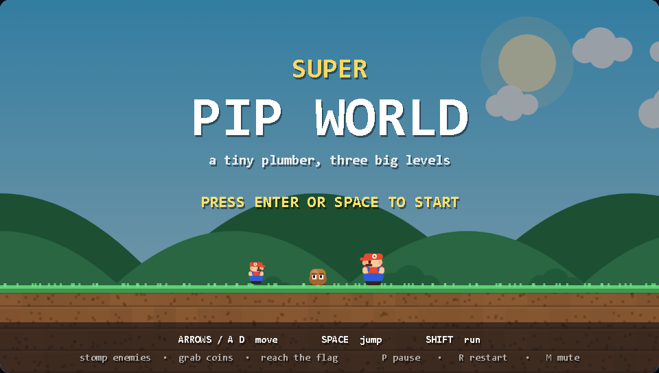
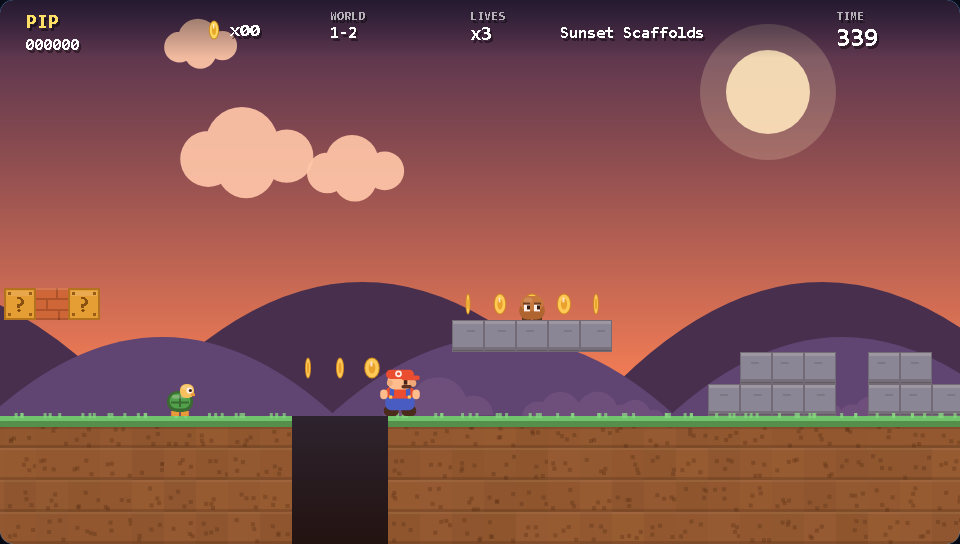

# Super Pip World

A Mario-style side-scrolling platformer that runs in a single file. Double-click
`index.html` — no build step, no server, no dependencies, no asset files. Every
pixel is drawn with canvas primitives and every sound is synthesised with
WebAudio at runtime.



## Play

Open `index.html` in any modern browser. Click the page once (or press a key) so
the browser lets the game start its audio.

| Action | Keys |
| --- | --- |
| Move | `←` `→` or `A` `D` |
| Jump | `Space`, `↑`, `W` or `Z` |
| Run | `Shift` or `X` (hold while moving) |
| Pause | `P` |
| Restart run | `R` |
| Mute | `M` |

On phones and tablets an on-screen D-pad appears automatically.

## What's in it

- **Momentum-based movement** — acceleration, friction, a run button, variable
  jump height (release early to hop lower), coyote time and jump buffering, so
  the controls feel forgiving rather than slippery.
- **Two enemy types** — Grumps that squash underfoot, and Shellbacks that pop
  out of their shell when stomped, then slide when kicked and knock out other
  enemies on the way.
- **Blocks** — `?` blocks pay coins, a hidden one grows a mushroom, bricks
  shatter if you're big, and everything bumps when hit from below.
- **Power-up** — the mushroom makes you big; being big lets you break bricks
  and survive one hit (you shrink instead of dying).
- **Three hand-tuned levels** with a day / dusk / night palette, each ending at
  a flagpole with a time bonus.
- **The usual furniture** — coins (100 = extra life), score, lives, countdown
  timer, parallax hills and clouds, screen shake, particle dust, brick debris
  and score popups.
- **Synthesised audio** — jump/coin/stomp/brick/power-up/death effects plus a
  low-volume looping arpeggio, all generated with oscillators.

## The levels

| # | Name | Look |
| --- | --- | --- |
| 1-1 | Mushroom Meadow | Bright day, gentle intro, pipes and brick rows |
| 1-2 | Sunset Scaffolds | Dusk, more floating platforms and wider pits |
| 1-3 | Midnight Ramparts | Night, staircase pyramids and tighter jumps |



## How it's put together

Everything lives in `index.html`, in one script organised as: constants →
audio → input → tile map and level builder → levels → entities → game rules →
rendering.

A few notes worth knowing if you want to change things:

- **Levels are code, not text grids.** Each level is built with a small fluent
  builder (`L.ground(...)`, `L.pit(...)`, `L.pipe(x, height)`, `L.steps(x,
  [1,2,3])`, `L.coins(...)`, `L.enemy('goomba', x)`), which keeps a 200 × 17
  grid readable and lets you resize a section without re-typing rows of ASCII
  art.
- **Tiles** are single characters: `X` ground, `=` stone, `B` brick, `?` coin
  block, `S` hidden mushroom block, `U` used block, `P` pipe, `c` coin.
- **Fixed timestep.** The game ticks logic at 1/60 s and clamps catch-up steps,
  so physics behave the same on a 60 Hz and a 144 Hz monitor.
- **Tuning knobs** are all named constants at the top (`JUMP_V`, `GRAVITY`,
  `MAX_RUN`, `COYOTE`, `BUFFER`, …).

## Tests

`tools/simulate.mjs` loads the game script into a fake DOM/canvas, then:

1. checks every level for blocked spawns, a missing floor or a flag with no
   ground under it,
2. drives a bot ("hold right, jump at walls and gaps") through all three levels
   to prove the terrain is actually completable,
3. renders every screen — title, gameplay, pause, level clear, game over, win —
   against a strict canvas stub that fails on unknown calls or NaN coordinates,
4. asserts the core mechanics: stomping, shell creation, mushroom pickup,
   shrink-on-damage, death, coin pickup, block contents and the level-clear
   trigger.

```sh
node tools/simulate.mjs
```

## Ideas if you want to keep going

Moving platforms, a fire-flower power-up, breakable-block puzzles, a boss
fight, checkpoints mid-level, a level editor that serialises the builder calls,
or per-level high scores in `localStorage`.

## License

MIT — see [LICENSE](LICENSE). Do what you like with it.
